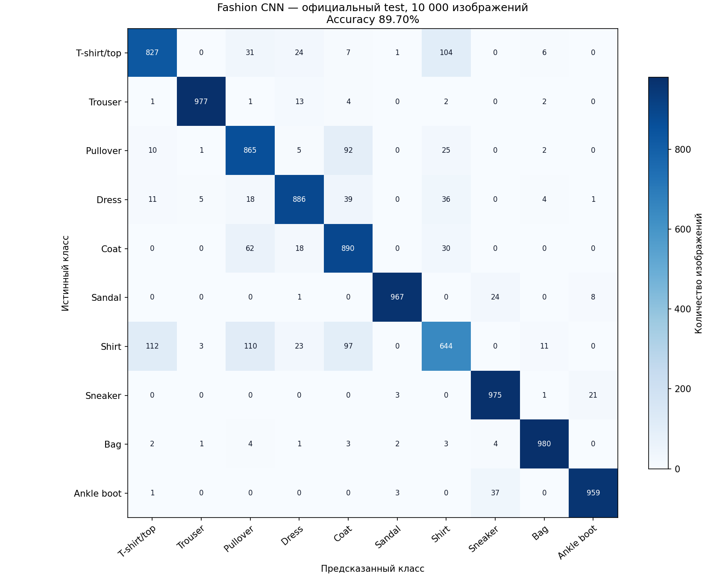

# Fashion CNN

Учебный классификатор изображений одежды на PyTorch. Небольшая свёрточная сеть получает чёрно-белое изображение **28×28** и выбирает один из десяти классов Fashion-MNIST.

В проекте есть загрузка данных через torchvision, разделение train/validation, обучение на CPU или CUDA, сохранение checkpoint и предсказание по загруженной модели.

## Данные

Используется [Fashion-MNIST от Zalando Research](https://github.com/zalandoresearch/fashion-mnist): 60 000 обучающих и 10 000 тестовых изображений. Исходная обучающая часть делится на **48 000 train и 12 000 validation** через `random_split` с seed 42. Официальный test не входит в это разбиение.

| ID | Класс | Описание |
| --- | --- | --- |
| 0 | T-shirt/top | Футболка или топ |
| 1 | Trouser | Брюки |
| 2 | Pullover | Пуловер |
| 3 | Dress | Платье |
| 4 | Coat | Пальто |
| 5 | Sandal | Сандалии |
| 6 | Shirt | Рубашка |
| 7 | Sneaker | Кроссовки |
| 8 | Bag | Сумка |
| 9 | Ankle boot | Ботильоны |

`transforms.ToTensor()` переводит изображение в тензор формы `[1, 28, 28]` со значениями от 0 до 1. Дополнительной нормализации и аугментаций в текущей версии нет. Данные автоматически скачиваются в `data/` при первом запуске, затем используются из локального кэша.

Источник данных и его [лицензия MIT](https://github.com/zalandoresearch/fashion-mnist/blob/master/LICENSE) указаны отдельно от лицензии кода этого проекта. Копии изображений в репозитории не распространяются.

## Архитектура

```text
Вход: 1 × 28 × 28
Conv2d(1 → 16, kernel=3, padding=1) → ReLU
MaxPool2d(2)                           → 16 × 14 × 14
Conv2d(16 → 32, kernel=3, padding=1) → ReLU
MaxPool2d(2)                           → 32 × 7 × 7
Flatten                               → 1568
Linear(1568 → 128) → ReLU
Linear(128 → 10)                      → logits классов
```

Всего **206 922 обучаемых параметра**. Последний слой выдаёт logits; для выбора класса используется `argmax`, отдельный softmax для этого не требуется.

| Настройка в `train.py` | Значение |
| --- | --- |
| Эпохи | 5 |
| Batch size | 64 |
| Оптимизатор | AdamW |
| Learning rate | 0.001 |
| Функция ошибки | CrossEntropyLoss |
| Устройство | CUDA, если доступна, иначе CPU |

## Результаты сохранённой модели

16 ноября 2026 года локальный checkpoint оценён без повторного обучения и подбора настроек:

| Выборка | Изображения | Accuracy | Cross-entropy на изображение |
| --- | ---: | ---: | ---: |
| Validation | 12 000 | **90,44%** | 0,2642 |
| Официальный test | 10 000 | **89,70%** | 0,2826 |



Точные результаты, матрицы ошибок, версии библиотек и SHA-256 checkpoint сохранены в [reports/metrics.json](reports/metrics.json). Validation-разбиение восстановлено по исходному коду с seed 42. Сам checkpoint хранит веса и названия классов, но не сохраняет историю обучения, индексы train/validation или номер эпохи. Поэтому соответствие именно этому разбиению предполагается по представленному скрипту.

## Запуск на Windows

Проверенное окружение: Python 3.13.2, PyTorch 2.10.0+cu126, torchvision 0.25.0+cu126. Основные версии зависимостей закреплены в `requirements.txt`; вариант сборки CPU/CUDA зависит от установки.

```powershell
git clone https://github.com/Awuiga/fashion-cnn.git
cd fashion-cnn
py -3.13 -m venv .venv
.\.venv\Scripts\Activate.ps1
python -m pip install -r requirements.txt
python -c "import torch; print(torch.__version__); print('CUDA:', torch.cuda.is_available())"

python train.py
python predict.py
python evaluate.py
```

При первом запуске понадобится интернет для загрузки Fashion-MNIST. Для установки конкретной CUDA-сборки используйте команду с [официальной страницы PyTorch](https://pytorch.org/get-started/locally/), сохраняя совместимую пару torch/torchvision.

### Что делают скрипты

- **`train.py`** обучает модель, выводит средний train loss после каждой эпохи, рассчитывает validation loss и accuracy, сохраняет последние веса и классы в `fashion_cnn.pt`. В исходной версии рассчитанные validation-метрики не печатаются; для их вывода есть `evaluate.py`.
- **`predict.py`** загружает checkpoint на CPU и печатает предсказанный и настоящий классы для первого изображения официального test. Это пример работы с одним объектом, а не оценка на всей выборке.
- **`evaluate.py`** оценивает checkpoint на validation и полном test, печатает метрики и сохраняет `reports/metrics.json`. Ничего не обучает и не изменяет веса. Дополнительные параметры путей доступны через `python evaluate.py --help`.

Готовые веса в Git не включены: после клонирования сначала запустите `train.py`. Повторный запуск обучения начинает новый эксперимент и перезаписывает локальный `fashion_cnn.pt`. Загружайте только доверенные checkpoints. После нового обучения `evaluate.py` обновит отчёт, и числа могут отличаться от опубликованных.

## Ограничения и воспроизводимость

- Seed 42 фиксирует только разбиение. Инициализация сети и порядок train-батчей отдельно не фиксируются, поэтому одинаковые результаты при новом обучении не гарантируются.
- Сохраняются последние веса, выбора лучшей эпохи и ранней остановки нет. Validation считается после всего обучения.
- Исходный `train.py` усредняет loss по батчам без поправки на размер последнего батча. `evaluate.py` считает средний loss по всем изображениям; эти величины могут немного отличаться.
- Сеть обучена на небольших стандартизированных изображениях Fashion-MNIST. Качество на обычных фотографиях одежды не проверялось; загрузка произвольного пользовательского изображения пока не реализована.
- Сохранённая история обучения недоступна, поэтому график train loss для исходного checkpoint не восстанавливался искусственно.

Логика пользовательских `train.py` и `predict.py` сохранена. Добавлен отдельный скрипт оценки. Проверки описаны в [VERIFICATION.md](VERIFICATION.md). Окружение, датасет, веса и рабочие логи исключены из Git. Отдельная открытая лицензия на код пока не выбрана автором.
